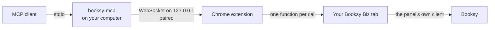

# booksy-mcp

[](LICENSE)


[](https://glama.ai/mcp/servers/PiotrZapolski/booksy-mcp)

booksy-mcp is a free, MIT-licensed MCP server for Booksy Biz. It lets Claude Code, Codex or Claude Desktop read your salon's calendar, staff schedules, clients, payments and reports through your own logged-in Chrome tab, so your session never leaves your computer: no API key, no hosted service, no third-party account. It is unofficial.

**Status:** used daily by the author on a live Booksy Biz salon panel. Booksy can change its panel at any time, so a tool may break until this project catches up; please open an issue when one does. The server is on npm as `booksy-biz-mcp`. The Chrome extension is not in the Chrome Web Store: the `setup` command unpacks it and you load it in Developer mode.

> ### Install in 3 minutes
>
> Paste this into Claude Code or Codex:
>
> ```text
> Install booksy-mcp following https://github.com/PiotrZapolski/booksy-mcp/blob/master/INSTALL.md and walk me through it step by step.
> ```
>
> Your agent does the setup. You only turn on Chrome Developer mode, click "Load unpacked", type a pairing code and restart the client. Or run `npx -y booksy-biz-mcp setup` yourself (see [Install](#install)). Polish: [README.pl.md](README.pl.md).

Unofficial. Not affiliated with, endorsed by or supported by Booksy. Read [Risks](#risks) first.

## When should I use booksy-mcp, and when not?

Use booksy-mcp when you want an AI assistant on your own computer to read your salon's data, and you
accept [the risks](#risks) of an unofficial tool.

Do not use it if you need a supported integration, if losing your Booksy account would
hurt, if no computer with Chrome and an open, logged-in panel tab is available, or if your assistant
can only connect to a remote MCP server.

| | booksy-mcp | Official Booksy API | Tools that copy your session or run in the cloud | Manual export from the panel |
| --- | --- | --- | --- | --- |
| Where the login session is | In your own Chrome tab. No session token is read, copied or stored | Not covered here: it is for partners, with no self-serve access for salon owners | Copied out of your browser or held by a service, depending on the tool | In your browser |
| Where client data goes | From your tab to your local server and your MCP client. The client's AI provider may process it. Exports are saved on your disk | Depends on the partner integration | Depends on the tool and may include its servers | Into files on your computer, then wherever you send them |
| Third-party account needed | No account for booksy-mcp itself. You still need your Booksy Biz login and your MCP client | Partner access | Depends on the tool | No |
| Licence | MIT | Not covered here | Depends on the tool | Not applicable |
| Maturity | In daily use by the author on a live panel; unofficial, can break when Booksy changes the panel | Not assessed here | Depends on the tool | Done by hand in the panel |

## What can I ask my assistant?

These questions map to existing read tools. Your assistant starts with the 37 core tools, and the rest are in [tool groups](#tool-groups) you turn on. Check important answers in the panel.

- "What is on my calendar tomorrow?" (`calendar_agenda`)
- "Who has free time on Friday?" (`calendar_open_slots`)
- "Which booking requests are waiting for confirmation?" (`appointment_requests`)
- "Show this week's staff hours and time off." (`staff_schedule`)
- "Find this client and show their past appointments." (`customer_cards`, `customer_visit_history`)
- "Summarize last month's payments." (`payment_summary`, needs the `payments` [tool group](#tool-groups))
- "What do the latest reviews say?" (`reviews_feed`)

## Why it works through your browser

Booksy Biz has no self-serve API for salon owners, and the panel is protected by your login session.
Copying that session to a script or a server is the wrong answer: whoever holds the session holds
your salon and your clients' data.

So this tool never touches the session. Every request is made **by the panel itself, in your own
tab**:

- **No session token is read, copied or stored.** The extension asks the panel's own HTTP client to
  make the call, so the panel adds its own login headers and our code never sees them.
- **Your real browser makes the request.** Nothing imitates a browser, because it is one. There is
  no captcha or bot-protection bypass. If Booksy shows a captcha or blocks a request, this tool stops.
- **Everything stays on your computer.** There is no hosted service and no telemetry. Data goes from
  your tab to your local server to your MCP client.



### Calm traffic

Requests stay at the pace of a person using the panel, so the tool puts no more load on Booksy than
you would. [Safe mode](#safe-mode) is on by default and sets the numbers.

- **One at a time.** There is a single queue, and requests are never parallel, in any mode.
- **Spaced and capped.** Gaps, budgets and limits are listed under [Safe mode](#safe-mode).
- **Cached.** Repeated reads are answered locally.
- **Only what the panel calls.** There is a fixed list of endpoints, enforced in the server and
  again in the extension.
- **No retries.** A 403, a 429, a block or a captcha stops everything at once, in any mode.

## Install

The npm package is [`booksy-biz-mcp`](https://www.npmjs.com/package/booksy-biz-mcp). The npm package
named `booksy-mcp` belongs to someone else and is not this project, so do not install it. The
command inside the package and the repository are still called `booksy-mcp`.

You need Node.js 20 or newer and Chrome 121 or newer.

### Install with npx (recommended)

```sh
npx -y booksy-biz-mcp setup
```

`setup` adds the server to Claude Code, Codex and Claude Desktop, whichever it finds. Each client
then starts the server with `npx -y booksy-biz-mcp`, so there is nothing to clone or build. It also
copies the Chrome extension out of the npm package to `~/booksy-mcp/extension`, tries to open
`chrome://extensions` and prints the next steps: load that folder in Chrome
([step 2](#2-load-the-extension)), restart your client and [pair](#4-pair).

Options: `--client claude-code|codex|claude-desktop|all`, `--dry-run` (show what would change and
change nothing), `--uninstall`, `--no-open`, `--extension-dir <folder>`. Agents follow
[INSTALL.md](INSTALL.md).

Wherever this README says `booksy-mcp <command>`, with npx you type
`npx -y booksy-biz-mcp <command>`.

To do by hand what `setup` does, follow steps 1 to 4. The [MCP Bundle](#claude-desktop-install-the-bundle)
and a [build from source](#build-from-source) are the other two ways to get the server.

### 1. Get the server

With npx there is nothing to install: `npx -y booksy-biz-mcp` downloads the package on first run and
starts the server on stdio.

### 2. Load the extension

The extension ships inside the npm package. `setup` copies it to `~/booksy-mcp/extension`. Without
`setup`, this command copies it to a folder you choose and prints the path:

```sh
npx -y booksy-biz-mcp extension ~/booksy-mcp/extension
```

The same extension is on every
[GitHub release](https://github.com/PiotrZapolski/booksy-mcp/releases/latest) as
`booksy-mcp-extension-<version>.zip`, if you prefer to download and unzip it.

1. Open `chrome://extensions` and turn on **Developer mode**.
2. Click **Load unpacked** and pick the folder with the extension.

After you update the package, copy the extension again and click the reload icon on its card in
`chrome://extensions`.

The extension asks for access to `booksy.com/pro`, the report frame on
`stats-and-reports.booksy.com` and the local port. It has no content script and leaves the panel untouched between calls. API calls to
`pl.booksy.com` are made by the panel page itself.

### 3. Add the server to your MCP client

**Claude Code**

```sh
claude mcp add booksy --scope user -- npx -y booksy-biz-mcp
```

**Claude Desktop** (`claude_desktop_config.json`)

```json
{
  "mcpServers": {
    "booksy": {
      "command": "npx",
      "args": ["-y", "booksy-biz-mcp"]
    }
  }
}
```

**Codex** (`~/.codex/config.toml`)

```toml
[mcp_servers.booksy]
command = "npx"
args = ["-y", "booksy-biz-mcp"]
```

Any other client that reads an `mcpServers` entry takes the same `command` and `args`.

### 4. Pair

1. Open [Booksy Biz](https://booksy.com/pro) in Chrome and log in.
2. Ask your assistant to run `session_status`. It shows an 8-character code.
3. Open the **Booksy MCP Bridge** extension popup, enter the code and click **Connect**.

Pairing happens once. `booksy-mcp reset-pairing` starts over.

Keep the panel tab open while you use the tools. If several panel tabs are open, the active one is
used, and the tools act on the salon open in that tab.

### Claude Desktop: install the bundle

Every [GitHub release](https://github.com/PiotrZapolski/booksy-mcp/releases/latest) carries an MCP
Bundle, and the official [MCP Registry](https://registry.modelcontextprotocol.io) lists the bundle
and the npm package as `io.github.PiotrZapolski/booksy-mcp`. With the bundle Claude Desktop needs no
terminal:

1. Download `booksy-mcp-<version>.mcpb` from the latest release and open it with Claude Desktop (or
   drag it into **Settings > Extensions**). Click **Install**.
2. Download `booksy-mcp-extension-<version>.zip` from the same release and unzip it. In Chrome open
   `chrome://extensions`, turn on **Developer mode**, click **Load unpacked** and pick the unzipped
   folder.
3. Pair as in [step 4](#4-pair) above.

The bundle takes its settings from `~/.config/booksy-mcp/config.json`, see
[Configuration](#configuration). The release also has the `server.json` sent to the registry, with
the SHA-256 of the bundle.

### Build from source

```sh
git clone https://github.com/PiotrZapolski/booksy-mcp.git
cd booksy-mcp
npm ci
npm run build
```

Then run `node dist/index.js setup`, which registers this build (`node /path/to/booksy-mcp/dist/index.js`)
instead of npx. By hand: load `extension/dist` as in step 2 and use `"command": "node"` with
`"args": ["/path/to/booksy-mcp/dist/index.js"]` in step 3.

The repository also ships a `.mcp.json` that starts the server from the local build (`node dist/index.js`), so Claude Code and other clients that read this file offer it when opened in the cloned folder after `npm run build`. For the published package, the same file would use `"command": "npx"` with `"args": ["-y", "booksy-biz-mcp"]`.

## Configuration

All settings are optional. Use environment variables, or `~/.config/booksy-mcp/config.json` with
the names in the second column. Environment variables win.

| Environment variable | `config.json` | Default | Meaning |
| --- | --- | --- | --- |
| `BOOKSY_MCP_WRITE_TOOLS` | `writeTools` | none | Write tools to enable, see [Writes](#writes) |
| `BOOKSY_MCP_TOOL_GROUPS` | `toolGroups` | `core` only | Tool groups to list besides `core`, or `all`, see [Tool groups](#tool-groups) |
| `BOOKSY_MCP_DISABLED_TOOLS` | `disabledTools` | none | Tools to turn off, reads included |
| `BOOKSY_MCP_EXPORT_DIR` | `exportDir` | `~/BooksyExports` | Where files are saved |
| `BOOKSY_MCP_REDACT_PII` | `redactPii` | off | Mask client e-mails and phone numbers, see [Security and privacy](#security-and-privacy) |
| `BOOKSY_MCP_SAFE_MODE` | `safeMode` | on | See [Safe mode](#safe-mode). Only `0`, `false`, `off`, `no` turn it off |
| `BOOKSY_MCP_MIN_INTERVAL_MS` | `minIntervalMs` | none | Longer gap. Cannot go below safe mode |
| `BOOKSY_MCP_MAX_REQUESTS_PER_HOUR` | `maxRequestsPerHour` | none | Lower hourly limit. Cannot go above safe mode |
| `BOOKSY_MCP_MAX_RESULT_CHARS` | `maxResultChars` | `150000` | Larger results go to a file |
| `BOOKSY_MCP_PORT` | `port` | `47821` | Local port, also set it in the extension |
| `BOOKSY_MCP_EXTENSION_ID` | `extensionIds` | built-in id | Accepted extension id |

Only one MCP client can use a port at a time. A second client gets a clear error. Give it another
port, or close the first one. A scheduled job (below) is the exception: it shares the port.

## Safe mode

Safe mode is on unless you turn it off with `BOOKSY_MCP_SAFE_MODE=0` or `"safeMode": false`. A typo
or any other value keeps it on. `session_status` shows the mode, the use of each budget and any
cooldown. All thresholds live in `src/config.ts`.

| Threshold | Safe mode | Safe mode off | Meaning |
| --- | --- | --- | --- |
| `minIntervalMs` | 4 s | none | Gap after the previous request has finished |
| `jitterRatio` | 1 | 0 | Random extra on any gap, so 4 s means 4 to 8 s |
| `writeIntervalMs` | 30 s | none | Gap between writes, which go one by one |
| `exportIntervalMs` | 60 s | none | Gap between report exports |
| `maxRequestsPerHour` | 120 | none | Requests in any 60 minutes |
| `maxRequestsPerDay` | 500 | none | Requests in any 24 hours |
| `maxExportsPerDay` | 15 | none | Report exports in any 24 hours |
| `maxExportsPerCall` | 5 | none | Reports in one `report_export_batch` |
| `maxPagesPerCall` | 15 | none | Requests one tool call may make |
| `maxRangeDays` | 92 | none | Longest range of a calendar or shift tool |
| `maxReportDays` | 366 | none | Longest period of a report |
| `windowDays` | 14 | 31 | Calendar ranges are read in windows of this length |
| `windowPauseMs` | 10 s | none | Pause between windows or weeks of one call |
| `cacheMultiplier` | 5 | 1 | Cache lives 5, 25 or 50 minutes instead of 1, 5 or 10 |
| `minFreshSeconds` | 60 | 0 | `fresh` still uses an answer younger than this |
| `blockCooldownMs` | 6 h | 15 min | Stop after a 429, a captcha or `request_blocked` |
| `forbiddenCooldownMs` | 1 h | 15 min | Stop after a plain 403, which can also mean a missing permission |

Budgets and a cooldown are kept in `traffic.json` in the state folder, so restarting your MCP client
does not reset them. That file holds timestamps and a reason, nothing else.

**A stop is a stop, in both modes.** After a 403, a 429, a captcha or `request_blocked`, nothing else
goes out, requests waiting in line are dropped, and nothing is retried. Check the panel in your
browser. If it works and you know why the stop happened, `booksy-mcp reset-cooldown` ends it early.
Tools cannot do that, so an assistant cannot lift a stop by itself.

**With safe mode off** there are no budgets and no gaps. Requests stay one at a time, and a stop still
stops. The server warns about this at start and in `session_status`. You take the risk.

## Tools

Names follow Booksy's own resources: `<resource>_<action>`. There are 89 read tools and 17 write
tools. Only the `core` group is listed by default, and single tools can still be turned off with
`BOOKSY_MCP_DISABLED_TOOLS`.

### Tool groups

Your assistant sees **37 tools by default**: the `core` group, which covers what a salon uses every
day. The other 52 read tools are in named groups that you turn on in the configuration. Fewer tools
at start means the assistant picks the right one more often.

| Group | Read tools | Write tools | What it contains |
| --- | --- | --- | --- |
| `core` | 37 | 15 | Always on. Session, calendar and appointments, staff and schedules, services, clients, reviews, notifications, waitlist, statistics and report exports |
| `payments` | 17 | 0 | Payments, checkout transactions, wallet and payouts, cash registers, invoices, `document_download` |
| `inventory` | 9 | 0 | Products, stock, warehouses, stock documents, brands, categories, suppliers |
| `vouchers` | 7 | 0 | Vouchers and gift cards, consent forms, loyalty cards |
| `marketing` | 8 | 2 | Message campaigns, SMS balance, client chat |
| `business` | 10 | 0 | Business profile, visibility, booking rules, integrations and other settings |
| `diagnostics` | 1 | 0 | `stats_frame_requests`, a check for verifying this project against a live panel |

Turn groups on in `~/.config/booksy-mcp/config.json`:

```json
{ "toolGroups": ["payments", "inventory"] }
```

or with an environment variable, which wins over the file:

```sh
BOOKSY_MCP_TOOL_GROUPS=payments,inventory
```

`"toolGroups": "all"` (or `BOOKSY_MCP_TOOL_GROUPS=all`) lists all 89 read tools. The setup command
saves the same choice for you: `npx -y booksy-biz-mcp setup --groups payments,inventory`, or
`--groups all`, or `--groups core` to go back to the default. Without `--groups`, setup does not
touch `config.json`. Restart your MCP client after a change.

- **Updating from 0.2.x:** until 0.2.2 every tool was listed. To keep everything as before, set
  `"toolGroups": "all"`.
- `session_status` lists every group with its state and size and says how to turn one on, so your
  assistant can tell you when a tool is missing because its group is off. Calling such a tool
  returns the error `tool_group_disabled` with the name of the group.
- Groups and writes are independent. A write tool is listed only when its group is on **and** it is
  enabled as described in [Writes](#writes). `BOOKSY_MCP_DISABLED_TOOLS` still turns off single
  tools.
- An unknown group name is ignored, with a warning on stderr at start and in `session_status`.
- [Scheduled jobs](#scheduled-jobs) do not depend on groups: `booksy-mcp job` works the same with
  any setting.

### Read

The group of each tool is in brackets after the heading or after the tool.

**Session and business** (`business`, except where marked)

- `session_status` (`core`): Shows whether the extension is connected, the pairing code when pairing is needed, the salon open in the panel, enabled write tools, tool groups (on, off, size, how to turn one on), the traffic mode, budget use and any cooldown.
- `opening_hours` (`core`): Opening hours of the business, day by day, for the week of the given date.
- `business_accounts`: Lists the businesses the logged-in user can open in the panel.
- `business_profile`: Public profile and core data of the business open in the panel tab.
- `business_visibility`: Whether the business is visible and bookable on the marketplace.
- `business_amenities`: Amenities shown on the business profile.
- `business_features`: Which panel features are on, off or available for this business.
- `business_booking_rules`: Booking rules set in the panel, grouped by category.
- `business_integrations`: Online booking integrations and their state.
- `business_notification_settings`: Staff and owner notification settings.
- `business_pos_settings`: Checkout and payment settings of the business.
- `business_no_show_protection`: Deposit and cancellation fee settings per service.

**Calendar and appointments** (`core`, except where marked)

- `calendar_agenda`: Appointments between two dates.
- `appointment_requests`: Appointments that wait for the salon to confirm or decline, from today on.
- `calendar_open_slots`: Free time per staff member on one date, worked out locally from shifts, time off and bookings.
- `appointment_changes_feed`: New, moved, cancelled and otherwise changed appointments since the last call.
- `calendar_month`: Counters and bookings for a month view of the calendar.
- `calendar_changed_dates`: Dates with calendar changes since a Unix timestamp, as the panel polls them.
- `appointment_details`: One appointment with its services, staff, client and price.
- `appointment_payment_details` (`payments`): Deposit, payment, tip and refund state of one appointment.

**Staff, stations and time** (`core`)

- `team_resources`: Staff members and stations.
- `staff_schedule`: Working hours and time off per staff member and day, to the minute, for any date range.
- `time_off_entries`: Time off of each staff member between two dates, with reason codes.
- `resource_details`: Details of one staff member or station.
- `resource_upcoming_bookings`: Next bookings of one staff member or station.
- `time_block_details`: One calendar time block, such as a break or a reserved slot.

**Services** (`core`)

- `service_menu`: All service categories with services, variants, prices and durations.
- `service_details`: One service with its variants and assigned staff.
- `service_addons`: Add-ons that can be sold with services.

**Clients** (`core`)

- `customer_cards`: Lists client cards, or searches them by name, phone or e-mail with query.
- `customer_card`: Full client card: contact data, notes, tags, visit and spending counters.
- `customer_visit_history`: Past and future appointments of one client.
- `customer_product_history`: Products one client bought.
- `customer_groups`: Client groups with their sizes.
- `customer_tags`: Tags used on client cards.
- `customer_file_download`: Saves a file attached to a client card as a local file.

**Campaigns and chat** (`marketing`)

- `campaign_estimate`: Number of recipients and SMS cost for a campaign.
- `chat_conversations`: Client chat conversations, newest first.
- `chat_messages`: Latest messages of one client conversation.
- `campaign_groups`: All message campaign templates, including automated campaigns and their automated_status.
- `campaign_details`: One campaign template: text, channel, audience and automation settings.
- `campaign_schedule`: Campaigns scheduled to go out.
- `campaign_sms_balance`: SMS limits, used and free messages, and the price per part.
- `chat_quick_actions`: Suggested quick actions for a client conversation.

**Reviews and notifications** (`core`)

- `reviews_feed`: Reviews of the business with ratings and replies.
- `panel_notifications`: The notification list from the panel bell.

**Reports and exports** (`core`, except where marked)

- `stats_overview`: The main statistics dashboard for a period.
- `stats_dashboard`: One statistics section with its figures and the list of reports inside it.
- `stats_report_catalog`: Every report key this salon can open, per statistics section.
- `stats_report_metadata`: What a report needs: its period limits and available filters.
- `stats_report`: One report as JSON, as the panel shows it.
- `stats_report_section`: One section of a report, for example one staff member or a later page of a table.
- `stats_billing_cycles`: Billing cycles usable as report periods.
- `report_export`: Downloads any report the panel offers as a file and saves it on this computer.
- `report_export_batch`: Saves several reports for one period, strictly one after another.
- `document_download` (`payments`): Saves a cash register report, cash document, invoice or consent as a local file.
- `stats_frame_requests` (`diagnostics`): A check for live verification. Shows which addresses the report frame asked for by itself, without ids, values or headers. Sends nothing to Booksy.

**Payments (read only)** (`payments`)

- `payment_rows`: Payment list with method, status and amounts, like the panel payments screen.
- `payment_summary`: Summary tiles of payments for a period.
- `checkout_transactions`: Checkout transactions for a period.
- `checkout_transaction`: One transaction with items, payments, tips and discounts.
- `checkout_last_receipt`: The latest receipt of a transaction.
- `booking_charges`: Appointments waiting for checkout or with booking charges.
- `payment_basket`: One payment basket with its deposit, payment and refund records.
- `refund_fee_preview`: Fees that would apply to refunding a payment.
- `wallet_overview`: Balance and overview from the payments financial center.
- `wallet_payouts`: Payout history.
- `cash_registers`: Cash registers and their open or closed state.
- `cash_register`: One cash register with totals.
- `cash_register_operations`: Cash in and out operations of one register.
- `invoices`: Invoices issued in the panel.
- `invoice`: One invoice.

**Products and warehouse** (`inventory`)

- `product_catalog`: Products with stock and prices.
- `product_stock_history`: Stock movements of one product in one warehouse.
- `warehouses`: Warehouses of the business.
- `warehouse_details`: One warehouse.
- `warehouse_documents`: Stock documents such as deliveries and internal use.
- `warehouse_document`: One stock document.
- `product_brands`: Product brands.
- `product_categories`: Product category tree.
- `product_suppliers`: Product suppliers.

**Vouchers, consents, loyalty, waitlist** (`vouchers`, except where marked)

- `vouchers`: Vouchers, gift cards and packages sold.
- `voucher_orders`: Voucher orders.
- `voucher_templates`: Voucher templates.
- `consent_forms`: Consent form templates.
- `consents_signed`: Consents assigned to clients.
- `waitlist` (`core`): Clients on the waitlist.
- `loyalty_program`: The current stamp card program.
- `loyalty_cards`: Client loyalty cards.

### Writes

All write tools are **off by default**, and a disabled tool does not exist for your assistant. Turn
on only what you need. 15 write tools are in the `core` group. `campaign_send` and `chat_reply`
are in `marketing`, so they also need that [tool group](#tool-groups):

```sh
BOOKSY_MCP_WRITE_TOOLS=appointment_move,appointment_confirm
```

`all` enables every write that stays inside the panel. Tools that reach clients directly
(`campaign_send`, `chat_reply`) are never part of `all` and have to be named.

A write needs three things to go through:

1. The tool is enabled on the server, and its tool group is on.
2. **Allow writes** is on in the extension popup. It is off by default.
3. It passes two steps. A call with `mode=dry_run` shows the exact request, asks Booksy to validate
   it where the panel has a preview, and returns a `confirm_token`. A second call with the same
   arguments, `mode=confirm` and that token sends it. The token works once, for 5 minutes, and only
   for that exact request. If your MCP client supports it, you are also asked directly.

Appointment tools make you say whether the client is notified. A held deposit requires an explicit
decision. An empty campaign audience is refused.

- `appointment_book`: Creates an appointment.
- `appointment_move`: Moves an appointment to a new start time and optionally another staff member, keeping the length of each service.
- `appointment_cancel`: Cancels an appointment.
- `appointment_confirm`: Accepts a booking request that waits for the salon.
- `appointment_decline`: Declines a booking request that waits for the salon.
- `appointment_mark_no_show`: Marks an appointment as a no-show.
- `time_off_add`: Adds time off for staff members.
- `time_off_remove`: Removes one time off entry.
- `time_block_add`: Blocks a part of the calendar for staff or stations, without a client.
- `time_block_remove`: Removes a calendar time block.
- `customer_add`: Adds a client card.
- `customer_update`: Changes the given fields of a client card.
- `customer_note_set`: Replaces the internal note on a client card.
- `customer_delete`: Deletes a client card.
- `review_reply`: Publishes a public reply to a review.
- `campaign_send` (reaches clients): Sends a one-off message campaign to clients.
- `chat_reply` (reaches clients): Sends a chat message to a client.

There are no tools for login, passwords, billing, payouts, refunds or charges. The refund tool is a
fee preview only.

### Exports

`report_export` saves any report the panel offers as a file, exactly as Booksy delivers it. It can
also convert it to CSV or return the rows as JSON. `stats_report_catalog` lists the report keys
available to your salon, because they depend on your plan and country. With `output=json` each sheet
gives the table under its real column labels, without title lines: `rows` up to the summary line,
`totals` for that line, and `rows_below_totals` for anything printed under it.

`calendar_agenda` splits long ranges into windows and reads them one after another with a pause. In
safe mode a range can have at most 92 days. `appointment_changes_feed` reports new, moved and cancelled appointments since
its last run, using a small local snapshot of ids, times and statuses.

## Scheduled jobs

`booksy-mcp job` saves a fixed list of reports, and optionally the staff schedule, without an MCP
client and without a language model. It is meant for a nightly task (launchd, cron, Task
Scheduler) on the computer where Chrome runs. It goes through the same extension, the same allowlist
and the same safe mode as the tools: the same gaps between requests and exports, the same budgets
(kept in the same `traffic.json`), the same range limits and the same stop after a 403, a 429 or a
captcha. A cooldown started by the job stops the MCP tools too, and the other way round.

```sh
booksy-mcp job \
  --exports appointments_list,clients_list,sales_summary \
  --from 2026-11-01 --to 2026-11-30 \
  --export sales_log:2026-10-01:2026-10-31 \
  --schedule 2026-11-01 2026-12-31 \
  --out ~/booksy-nightly --open-panel --jitter 900
```

| Option | Meaning |
| --- | --- |
| `--exports a,b` with `--from`, `--to` | Report keys from `stats_report_catalog`, for one period |
| `--export key[:from:to]` | One report with its own period. Can repeat |
| `--time-span` | Period type sent to Booksy. Default `month` for a whole month, otherwise `between` |
| `--out <folder>` | Files are saved as `<key>_<from>_<to>.xlsx` |
| `--schedule <from> <to>` | Also save the staff schedule, to `<out>/schedule.json` or `--schedule-out` |
| `--summary <file>` | The summary JSON, by default `<out>/summary.json`. Also printed on stdout |
| `--open-panel` | When no Booksy Biz tab is open, the extension opens one in the background (a new inactive tab in an open window) and closes it at the end. Off by default. It never closes a tab you opened |
| `--jitter <seconds>` | Waits a random time from 0 to this before the first request, so the start time differs each day |

The schedule file lists every staff member for every day of the range: `minutes` (shifts minus the
time off inside them), `scheduled_minutes`, `time_off_minutes`, the shift hours and a sum per month.

Exit codes: `0` everything saved, `1` part of it, `2` nothing saved, `3` no extension, no panel tab
or not logged in, `4` a cooldown, a block by Booksy, a captcha or a used-up budget. The summary says
for each report whether it was saved and why not. After a `3` or `4` the job stops and marks the rest
as not tried. Do not retry a `4` in a loop: wait until the cooldown is over.

### Agenda for SMS reminders

`booksy-mcp job --agenda --from <date> --to <date> [--open-panel] [--jitter N]` reads the calendar
for the range (one request when the range fits in one calendar window) and prints one JSON object on
stdout: `status`, `range_from`, `range_to`, `complete`, `fetched_at` and `visits`, each with
`visit_id`, local `start` and `end`, `status`, `updated_epoch`, `service`, `staff` (names),
`customer_id`, `customer_name` and `phone`. It writes no files, because the result holds phone
numbers: pipe it straight to where it goes. A failed run prints nothing on stdout, the exit code and
the `agenda failed: <code>` line on stderr say why. It refuses to run when contact details are
masked (`redactPii`).

The calendar shows only the phone from the salon's own client card, so customers who booked in the
Booksy app come without one. For them the job reads the appointment details
(`{B}/appointments/:appointmentUid/`, the `merged_data`, then `customer_profile`, then
`business_customer` cell phone): one request per customer, earliest visit first, at most
`--details-limit` per run (default 30, `0` reads none), each with the usual safe mode gap. Pass
`--known-customers <file>` (customer ids, one per line, no phone numbers) to skip customers whose
phone you already have. A block, captcha or used-up budget stops these reads without a retry and the
job still prints the calendar it has; `complete` describes the calendar only.

**Port.** When an MCP client already runs `booksy-mcp` on the port, the job does not fail and does
not wait. It connects to that server as a relay: it proves the same pairing secret from the config
folder, and the server passes the job's calls to the extension in its own one-at-a-time line. So
there is still one pairing and one extension connection, and requests of the job and of the tools
never overlap. When no server runs, the job takes the port itself for the time it runs. `--open-panel` needs the
extension from version 0.2.0. With an older one the job exits `3` with `extension_outdated`: reload
the extension in `chrome://extensions`. Run the job
with the same `BOOKSY_MCP_CONFIG_DIR` as your MCP client (the default is the same).

How long it takes: in safe mode exports are at least 60 to 120 s apart, so six reports and two months
of schedule take about 10 to 15 minutes, plus the jitter. Safe mode allows 15 exports per 24 hours.

## Security and privacy

- The bridge listens on `127.0.0.1` only, and checks both `Host` and `Origin`, so web pages cannot
  reach it.
- Pairing uses a one-time code, valid for 10 minutes, with 5 attempts. After that, both sides prove
  a shared secret to each other on every connection. That secret only opens the local bridge.
- The wire protocol carries an allowlist rule id and parameter values, never a URL. The extension
  checks the rule again by itself.
- Your assistant receives what the tools return, including client data. Your MCP client's provider
  may process it under its own terms. You remain responsible for your clients' personal data.
- `BOOKSY_MCP_REDACT_PII=1` (`redactPii: true`) masks e-mails and phone numbers in everything tools
  return, including `report_export` with `output=json`: `jan@example.com` becomes `ja***om`. It
  applies to contact fields and to e-mails and `+` numbers inside free text. Names are not masked,
  and neither is a file: exports saved on disk stay exactly as Booksy delivered them, the CSV
  included. Off by default, because an assistant then cannot call or write to a client for you.
  The former name `BOOKSY_MCP_MASK_CONTACTS` still works.
- Exports and snapshots are written with owner-only permissions. Delete them when you are done.

Client chat is the one exception to "no token handled": chat messages live with a third-party chat
provider, reachable with a chat token that Booksy issues to the panel. The token is requested and
used inside the tab and is never returned. It is not your session token, and it is only used by the
chat tools.

## Risks

Read this before you use the tool. It is not legal advice.

- **Unofficial API.** This uses the private API of the panel. Booksy can change it at any time, and
  tools can stop working or return wrong data without warning. Check important numbers in the panel.
- **Booksy's terms.** Booksy's terms limit use of the app to its intended purpose, and some versions
  explicitly forbid automated tools and reverse engineering. Read the terms that apply to you
  ([Poland](https://booksy.com/pro/terms/pl.html), [US](https://booksy.com/pro/terms/us.html)).
- **Your account can be blocked.** Booksy can suspend or terminate an account for a breach of its
  terms, in some cases immediately and without compensation. Safe mode keeps the load low, but it
  does not remove the risk or change what the terms say.
- **Your business depends on that account.** If losing it would hurt, think twice.
- **Writes affect real people.** They change real appointments and can message real clients and
  cost money.

**You use this tool at your own risk.** It comes with no warranty, as the licence says.

## FAQ

### Does Booksy have an official API or MCP server for salon owners?

booksy-mcp is an unofficial MCP server for Booksy Biz, not an official Booksy product. Booksy Biz has
no self-serve API for salon owners: the official API is for partners. This project therefore works
through the panel in your own browser.

### Is booksy-mcp safe for my Booksy account?

booksy-mcp cannot promise that your account is safe: Booksy can suspend or terminate an account for a
breach of its terms, and some versions of the terms forbid automated tools. [Safe mode](#safe-mode)
keeps traffic low and the tool stops after a 403, a 429 or a captcha, but this does not remove the
risk. Read [Risks](#risks) before you use it.

### Which MCP clients are supported?

booksy-mcp setup configures Claude Code, Codex and Claude Desktop. The server runs locally over
stdio and has no remote URL. `setup` does not configure the ChatGPT app; with OpenAI tools, the
supported route is Codex.

### Does it work without Chrome?

No, booksy-mcp needs Chrome 121 or newer with its extension, plus an open Booksy Biz tab where you
are logged in. This applies to [scheduled jobs](#scheduled-jobs) too.

### Can it create or change bookings?

booksy-mcp has [write tools](#writes) that book, move and cancel appointments, but all write tools are
off by default. You have to enable each tool on the server and turn on **Allow writes** in the
extension, and every write takes a dry run followed by a confirmation.

### Is it free?

Yes, booksy-mcp is free and [MIT-licensed](LICENSE). Your Booksy account, your AI assistant and
campaign SMS messages are separate and keep their own terms and prices.

## Directory listing

For MCP directories such as [mcpservers.org](https://mcpservers.org):

- **Name:** Booksy Biz (booksy-mcp)
- **Category:** Business / Productivity
- **Short description:** Booksy Biz through your own logged-in browser tab: calendar, staff, clients,
  payments and report exports, with calm traffic and writes off by default.

The official MCP Registry entry is `io.github.PiotrZapolski/booksy-mcp`. Its source is
[server.json](server.json), and the release workflow fills in the bundle URL and SHA-256 for each
version tag.

The [Dockerfile](Dockerfile) exists for directories that inspect the server: the image starts on
stdio and answers `initialize` and `tools/list` with no browser. For real use run the server on the
computer where Chrome runs.

## Development

```sh
npm ci
npm run check   # lint, typecheck, tests
npm run build
```

- `src/shared/allowlist.ts`: every request this project can make.
- `extension/src/page.ts`: the code that runs in the panel tab.
- `docs/endpoints.md`: what the panel's public JavaScript shows.
- `docs/verification.md`: the per-tool checklist for checks against a live panel.

A release is a version tag: bump the version in `package.json`, `src/server.ts`, `server.json` and
`mcpb/manifest.json` (a test keeps them equal), merge, then push the tag `v<version>`. The
`release` workflow builds the bundle (`node scripts/build-mcpb.mjs`), attaches it to the GitHub
release and publishes to the MCP Registry.

## Licence

[MIT](LICENSE)
