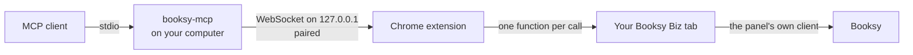

# booksy-mcp

An [MCP](https://modelcontextprotocol.io) server for **Booksy Biz**. It lets your AI assistant read
your salon's calendar, staff schedules, clients, payments and reports through your own logged-in
browser tab.

> **Status: pre-release.** The tools were built from the panel's public JavaScript and tested with
> synthetic data. They have not yet been run against a live panel, so expect some to need fixes.
> See [docs/verification.md](docs/verification.md). Not yet published to npm or the Chrome Web Store.

Unofficial. Not affiliated with, endorsed by or supported by Booksy. Read [Risks](#risks) first.

## Why it works through your browser

Booksy Biz has no self-serve API for salon owners, and the panel is protected by your login session.
Copying that session to a script or a server is the wrong answer: whoever holds the session holds
your salon and your clients' data.

So this tool never touches the session. Every request is made **by the panel itself, in your own
tab**:

- **No session token is read, copied or stored.** The extension asks the panel's own HTTP client to
  make the call, so the panel adds its own login headers and our code never sees them.
- **Your real browser makes the request.** Nothing imitates a browser, because it is one. There is
  no captcha or bot-protection bypass. If Booksy shows a captcha or blocks a request, this tool stops.
- **Everything stays on your computer.** There is no hosted service and no telemetry. Data goes from
  your tab to your local server to your MCP client.



### Calm traffic

Requests should look like a person using the panel, because that is what the panel expects:

- **One at a time.** There is a single queue, and requests are never parallel.
- **Spaced.** At least 2 seconds apart, with some random extra time. You can raise this, but it cannot
  go below 1 second.
- **Capped.** At most 300 requests per hour by default.
- **Cached.** Repeated reads are answered locally, for 1 to 10 minutes depending on the data.
- **Only what the panel calls.** There is a fixed list of endpoints, enforced in the server and
  again in the extension.
- **No retries.** A 429, a block or a captcha pauses everything for 15 minutes. So do three 403
  answers in a row.

## Install

You need Node.js 20 or newer and Chrome 116 or newer.

### 1. Get the code

Until the package is on npm, build it from source:

```sh
git clone https://github.com/PiotrZapolski/booksy-mcp.git
cd booksy-mcp
npm ci
npm run build
```

Once published, `npx -y booksy-mcp` will replace the path used below.

### 2. Load the extension

1. Open `chrome://extensions` and turn on **Developer mode**.
2. Click **Load unpacked** and pick the `extension/dist` folder.

After publishing, `npx -y booksy-mcp extension` will copy the extension to a folder and print its
path.

The extension asks for access to `booksy.com/pro` and the local port. It has no content script and
leaves the panel untouched between calls.

### 3. Add the server to your MCP client

**Claude Code**

```sh
claude mcp add booksy -- node /path/to/booksy-mcp/dist/index.js
```

**Claude Desktop** (`claude_desktop_config.json`)

```json
{
  "mcpServers": {
    "booksy": {
      "command": "node",
      "args": ["/path/to/booksy-mcp/dist/index.js"]
    }
  }
}
```

**Codex** (`~/.codex/config.toml`)

```toml
[mcp_servers.booksy]
command = "node"
args = ["/path/to/booksy-mcp/dist/index.js"]
```

### 4. Pair

1. Open [Booksy Biz](https://booksy.com/pro) in Chrome and log in.
2. Ask your assistant to run `session_status`. It shows an 8-character code.
3. Open the **Booksy MCP Bridge** extension popup, enter the code and click **Connect**.

Pairing happens once. `booksy-mcp reset-pairing` starts over.

Keep the panel tab open while you use the tools. If several panel tabs are open, the active one is
used, and the tools act on the salon open in that tab.

## Configuration

All settings are optional. Use environment variables, or `~/.config/booksy-mcp/config.json` with
the names in the second column. Environment variables win.

| Environment variable | `config.json` | Default | Meaning |
| --- | --- | --- | --- |
| `BOOKSY_MCP_WRITE_TOOLS` | `writeTools` | none | Write tools to enable, see [Writes](#writes) |
| `BOOKSY_MCP_DISABLED_TOOLS` | `disabledTools` | none | Tools to turn off, reads included |
| `BOOKSY_MCP_EXPORT_DIR` | `exportDir` | `~/BooksyExports` | Where files are saved |
| `BOOKSY_MCP_MASK_CONTACTS` | `maskContacts` | off | Mask phones and e-mails in tool output |
| `BOOKSY_MCP_MIN_INTERVAL_MS` | `minIntervalMs` | `2000` | Gap between requests, minimum 1000 |
| `BOOKSY_MCP_MAX_REQUESTS_PER_HOUR` | `maxRequestsPerHour` | `300` | Hourly limit |
| `BOOKSY_MCP_MAX_RESULT_CHARS` | `maxResultChars` | `150000` | Larger results go to a file |
| `BOOKSY_MCP_PORT` | `port` | `47821` | Local port, also set it in the extension |
| `BOOKSY_MCP_EXTENSION_ID` | `extensionIds` | built-in id | Accepted extension id |

Only one MCP client can use a port at a time. A second client gets a clear error. Give it another
port, or close the first one.

## Tools

Names follow Booksy's own resources: `<resource>_<action>`. There are many tools, so if your client
loads all of them at start, turn off what you do not need with `BOOKSY_MCP_DISABLED_TOOLS`.

### Read

**Session and business**

- `session_status`: Shows whether the extension is connected, the pairing code when pairing is needed, the salon open in the panel, enabled write tools and the request budget.
- `opening_hours`: Opening hours of the business, day by day, for the week of the given date.
- `business_accounts`: Lists the businesses the logged-in user can open in the panel.
- `business_profile`: Public profile and core data of the business open in the panel tab.
- `business_visibility`: Whether the business is visible and bookable on the marketplace.
- `business_amenities`: Amenities shown on the business profile.
- `business_features`: Which panel features are on, off or available for this business.
- `business_booking_rules`: Booking rules set in the panel, grouped by category.
- `business_integrations`: Online booking integrations and their state.
- `business_notification_settings`: Staff and owner notification settings.
- `business_pos_settings`: Checkout and payment settings of the business.
- `business_no_show_protection`: Deposit and cancellation fee settings per service.

**Calendar and appointments**

- `calendar_agenda`: Appointments between two dates.
- `appointment_requests`: Appointments that wait for the salon to confirm or decline, from today on.
- `calendar_open_slots`: Free time per staff member on one date, worked out locally from shifts, time off and bookings.
- `appointment_changes_feed`: New, moved, cancelled and otherwise changed appointments since the last call.
- `calendar_month`: Counters and bookings for a month view of the calendar.
- `calendar_changed_dates`: Dates with calendar changes since a Unix timestamp, as the panel polls them.
- `appointment_details`: One appointment with its services, staff, client and price.
- `appointment_payment_details`: Deposit, payment, tip and refund state of one appointment.

**Staff, stations and time**

- `team_resources`: Staff members and stations.
- `staff_schedule`: Working hours and time off per staff member and day, to the minute, for any date range.
- `time_off_entries`: Time off of each staff member between two dates, with reason codes.
- `resource_details`: Details of one staff member or station.
- `resource_upcoming_bookings`: Next bookings of one staff member or station.
- `time_block_details`: One calendar time block, such as a break or a reserved slot.

**Services**

- `service_menu`: All service categories with services, variants, prices and durations.
- `service_details`: One service with its variants and assigned staff.
- `service_addons`: Add-ons that can be sold with services.

**Clients**

- `customer_cards`: Lists client cards, or searches them by name, phone or e-mail with query.
- `customer_card`: Full client card: contact data, notes, tags, visit and spending counters.
- `customer_visit_history`: Past and future appointments of one client.
- `customer_product_history`: Products one client bought.
- `customer_groups`: Client groups with their sizes.
- `customer_tags`: Tags used on client cards.
- `customer_file_download`: Saves a file attached to a client card as a local file.

**Campaigns and chat**

- `campaign_estimate`: Number of recipients and SMS cost for a campaign.
- `chat_conversations`: Client chat conversations, newest first.
- `chat_messages`: Latest messages of one client conversation.
- `campaign_groups`: All message campaign templates, including automated campaigns and their automated_status.
- `campaign_details`: One campaign template: text, channel, audience and automation settings.
- `campaign_schedule`: Campaigns scheduled to go out.
- `campaign_sms_balance`: SMS limits, used and free messages, and the price per part.
- `chat_quick_actions`: Suggested quick actions for a client conversation.

**Reviews and notifications**

- `reviews_feed`: Reviews of the business with ratings and replies.
- `panel_notifications`: The notification list from the panel bell.

**Reports and exports**

- `stats_overview`: The main statistics dashboard for a period.
- `stats_dashboard`: One statistics section with its figures and the list of reports inside it.
- `stats_report_catalog`: Every report key this salon can open, per statistics section.
- `stats_report_metadata`: What a report needs: its period limits and available filters.
- `stats_report`: One report as JSON, as the panel shows it.
- `stats_report_section`: One section of a report, for example one staff member or a later page of a table.
- `stats_billing_cycles`: Billing cycles usable as report periods.
- `report_export`: Downloads any report the panel offers as a file and saves it on this computer.
- `report_export_batch`: Saves several reports for one period, strictly one after another.
- `document_download`: Saves a cash register report, cash document, invoice or consent as a local file.

**Payments (read only)**

- `payment_rows`: Payment list with method, status and amounts, like the panel payments screen.
- `payment_summary`: Summary tiles of payments for a period.
- `checkout_transactions`: Checkout transactions for a period.
- `checkout_transaction`: One transaction with items, payments, tips and discounts.
- `checkout_last_receipt`: The latest receipt of a transaction.
- `booking_charges`: Appointments waiting for checkout or with booking charges.
- `payment_basket`: One payment basket with its deposit, payment and refund records.
- `refund_fee_preview`: Fees that would apply to refunding a payment.
- `wallet_overview`: Balance and overview from the payments financial center.
- `wallet_payouts`: Payout history.
- `cash_registers`: Cash registers and their open or closed state.
- `cash_register`: One cash register with totals.
- `cash_register_operations`: Cash in and out operations of one register.
- `invoices`: Invoices issued in the panel.
- `invoice`: One invoice.

**Products and warehouse**

- `product_catalog`: Products with stock and prices.
- `product_stock_history`: Stock movements of one product in one warehouse.
- `warehouses`: Warehouses of the business.
- `warehouse_details`: One warehouse.
- `warehouse_documents`: Stock documents such as deliveries and internal use.
- `warehouse_document`: One stock document.
- `product_brands`: Product brands.
- `product_categories`: Product category tree.
- `product_suppliers`: Product suppliers.

**Vouchers, consents, loyalty, waitlist**

- `vouchers`: Vouchers, gift cards and packages sold.
- `voucher_orders`: Voucher orders.
- `voucher_templates`: Voucher templates.
- `consent_forms`: Consent form templates.
- `consents_signed`: Consents assigned to clients.
- `waitlist`: Clients on the waitlist.
- `loyalty_program`: The current stamp card program.
- `loyalty_cards`: Client loyalty cards.

### Writes

All write tools are **off by default**, and a disabled tool does not exist for your assistant. Turn
on only what you need:

```sh
BOOKSY_MCP_WRITE_TOOLS=appointment_move,appointment_confirm
```

`all` enables every write that stays inside the panel. Tools that reach clients directly
(`campaign_send`, `chat_reply`) are never part of `all` and have to be named.

A write needs three things to go through:

1. The tool is enabled on the server.
2. **Allow writes** is on in the extension popup. It is off by default.
3. It passes two steps. A call with `mode=dry_run` shows the exact request, asks Booksy to validate
   it where the panel has a preview, and returns a `confirm_token`. A second call with the same
   arguments, `mode=confirm` and that token sends it. The token works once, for 5 minutes, and only
   for that exact request. If your MCP client supports it, you are also asked directly.

Appointment tools make you say whether the client is notified. A held deposit requires an explicit
decision. An empty campaign audience is refused.

- `appointment_book`: Creates an appointment.
- `appointment_move`: Moves an appointment to a new start time and optionally another staff member, keeping the length of each service.
- `appointment_cancel`: Cancels an appointment.
- `appointment_confirm`: Accepts a booking request that waits for the salon.
- `appointment_decline`: Declines a booking request that waits for the salon.
- `appointment_mark_no_show`: Marks an appointment as a no-show.
- `time_off_add`: Adds time off for staff members.
- `time_off_remove`: Removes one time off entry.
- `time_block_add`: Blocks a part of the calendar for staff or stations, without a client.
- `time_block_remove`: Removes a calendar time block.
- `customer_add`: Adds a client card.
- `customer_update`: Changes the given fields of a client card.
- `customer_note_set`: Replaces the internal note on a client card.
- `customer_delete`: Deletes a client card.
- `review_reply`: Publishes a public reply to a review.
- `campaign_send` (reaches clients): Sends a one-off message campaign to clients.
- `chat_reply` (reaches clients): Sends a chat message to a client.

There are no tools for login, passwords, billing, payouts, refunds or charges. The refund tool is a
fee preview only.

### Exports

`report_export` saves any report the panel offers as a file, exactly as Booksy delivers it. It can
also convert it to CSV or return the rows as JSON. `stats_report_catalog` lists the report keys
available to your salon, because they depend on your plan and country.

Ranges of any length work in `calendar_agenda`. Long ranges are split into windows of 31 days and read
one after another. `appointment_changes_feed` reports new, moved and cancelled appointments since
its last run, using a small local snapshot of ids, times and statuses.

## Security and privacy

- The bridge listens on `127.0.0.1` only, and checks both `Host` and `Origin`, so web pages cannot
  reach it.
- Pairing uses a one-time code, valid for 10 minutes, with 5 attempts. After that, both sides prove
  a shared secret to each other on every connection. That secret only opens the local bridge.
- The wire protocol carries an allowlist rule id and parameter values, never a URL. The extension
  checks the rule again by itself.
- Your assistant receives what the tools return, including client data. Your MCP client's provider
  may process it under its own terms. You remain responsible for your clients' personal data. Use
  `BOOKSY_MCP_MASK_CONTACTS=1` to mask phones and e-mails.
- Exports and snapshots are written with owner-only permissions. Delete them when you are done.

Client chat is the one exception to "no token handled": chat messages live with a third-party chat
provider, reachable with a chat token that Booksy issues to the panel. The token is requested and
used inside the tab and is never returned. It is not your session token, and it is only used by the
chat tools.

## Risks

Read this before you use the tool. It is not legal advice.

- **Unofficial API.** This uses the private API of the panel. Booksy can change it at any time, and
  tools can stop working or return wrong data without warning. Check important numbers in the panel.
- **Booksy's terms.** Booksy's terms limit use of the app to its intended purpose, and some versions
  explicitly forbid automated tools and reverse engineering. Read the terms that apply to you
  ([Poland](https://booksy.com/pro/terms/pl.html), [US](https://booksy.com/pro/terms/us.html)).
- **Your account can be blocked.** Booksy can suspend or terminate an account for a breach of its
  terms, in some cases immediately and without compensation. Careful traffic lowers the chance of
  being noticed, but it does not remove the risk or change what the terms say.
- **Your business depends on that account.** If losing it would hurt, think twice.
- **Writes affect real people.** They change real appointments and can message real clients and
  cost money.

**You use this tool at your own risk.** It comes with no warranty, as the licence says.

## Directory listing

For MCP directories such as [mcpservers.org](https://mcpservers.org):

- **Name:** Booksy Biz (booksy-mcp)
- **Category:** Business / Productivity
- **Short description:** Booksy Biz through your own logged-in browser tab: calendar, staff, clients,
  payments and report exports, with calm traffic and writes off by default.

The official MCP Registry entry is in [server.json](server.json).

## Development

```sh
npm ci
npm run check   # lint, typecheck, tests
npm run build
```

- `src/shared/allowlist.ts`: every request this project can make.
- `extension/src/page.ts`: the code that runs in the panel tab.
- `docs/endpoints.md`: what the panel's public JavaScript shows.
- `docs/verification.md`: what still has to be confirmed in a live panel.

## Licence

[MIT](LICENSE)
